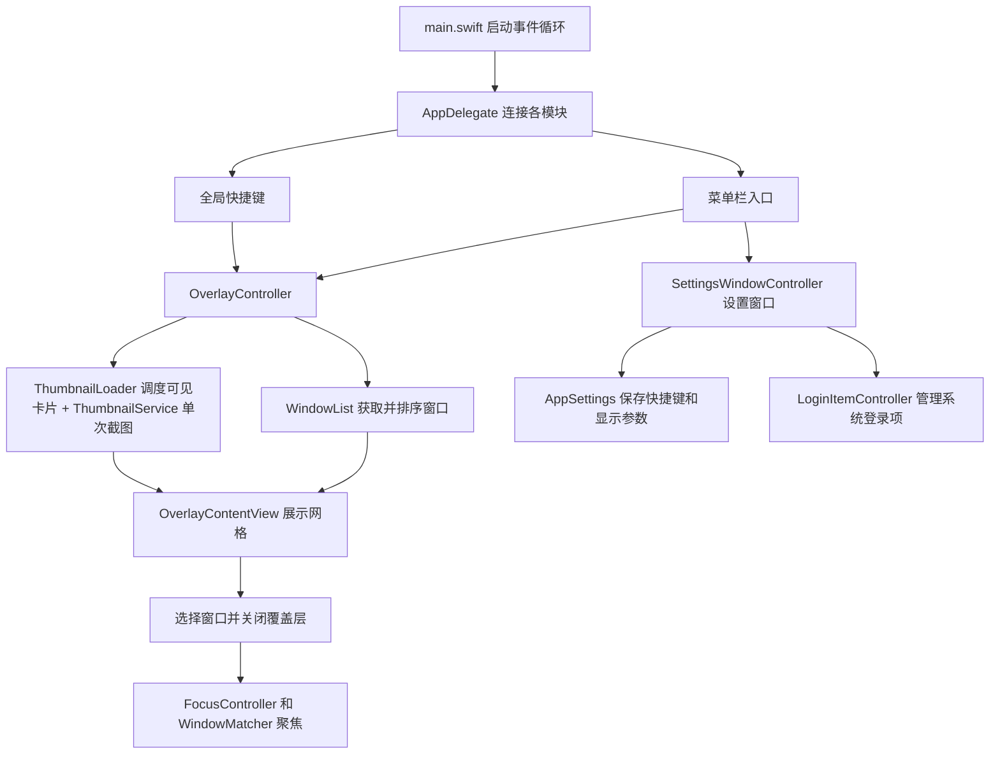

# TaskView 开发说明

TaskView 是使用 Swift 与 AppKit 实现的 macOS 菜单栏窗口切换工具。界面原生绘制，不使用 WebView；系统集成使用 Carbon、ScreenCaptureKit、辅助功能接口和 ServiceManagement。最低系统版本为 macOS 14，目前构建目标仅为 Apple Silicon。

## 运行流程

应用空闲时等待事件；打开任务视图才读取窗口、截图。关闭覆盖层时取消加载与截图任务，移除卡片和窗口数据。覆盖层窗口及设置窗口会保留以便下次打开，关闭界面不等于清空 AppKit 或系统的所有缓存。

## 源码：Sources/TaskView

| 文件 | 职责与关键行为 |
| --- | --- |
| `main.swift` | 创建 NSApplication，在主执行器中持有 AppDelegate，使用 accessory 激活策略进入事件循环；不显示 Dock 图标。 |
| `AppDelegate.swift` | 组装应用：安装菜单栏、注册已保存的快捷键、首次权限引导；处理失焦、退出、设置窗口打开；验证并保存快捷键变更；录制时暂时注销全局热键。 |
| `StatusItemController.swift` | 创建和持有 NSStatusItem；建立打开、设置、权限跳转与退出菜单；更新快捷键悬浮提示。 |
| `GlobalHotKey.swift` | 用 Carbon 注册系统快捷键；先注册新组合再释放旧组合；注册失败保留旧组合；过滤已失效的排队事件。HotKeyBackend 是测试替代接口，CarbonHotKeyBackend 是真实实现。 |
| `AppSettings.swift` | Shortcut 定义硬件键码、修饰键与显示名称，校验组合；AppPreferences 定义悬停、压暗和截图清晰度；AppSettings 从 UserDefaults 加载和保存。PreferencesStore 允许测试使用内存存储。 |
| `SettingsWindowController.swift` | AppKit 设置窗口及滚动布局；连接快捷键、自启、悬停、滑块与清晰度控件；显示当前应用路径和权限；用户主动重新检查权限。ShortcutRecorderButton 接收按键，Esc、失焦和关闭时结束录制。 |
| `LoginItemController.swift` | 包装 SMAppService.mainApp 的真实注册状态；启用、取消自启；显示等待批准和失败信息；系统状态变化时刷新，不以本地布尔值假装注册成功。 |
| `Permissions.swift` | 读取屏幕录制与辅助功能状态；记录实际窗口读取成功或明确权限拒绝；区分权限错误和一般系统错误；请求权限、打开对应系统设置、执行显式复查。 |
| `WindowList.swift` | 定义 WindowItem；取得屏幕上普通窗口，排除自身、非普通层级和较小窗口；按窗口服务器的前后顺序排序；每次读取按应用复用图标，缺失时使用通用图标。保留原始标题供聚焦匹配。 |
| `WindowQuery.swift` | 纯元信息查询，返回原始窗口索引；支持中文、多词、忽略大小写 / 重音的标题和应用名搜索；显示器相交筛选；按应用进程稳定分组；转换 NSScreen 到窗口坐标。 |
| `ThumbnailLoader.swift` | 泛型异步截图调度器；只加载当前可见索引，最多四路；离开视口清除图片；快速重新打开时，等待不能立即取消的旧截图返回；会话编号阻止旧图回填；失败不循环重试。 |
| `ThumbnailService.swift` | 每次调用执行一次单窗口截图；按最长边 480、960 或 1440 像素等比缩小，关闭鼠标光标；返回 NSImage，不创建持续视频流。 |
| `OverlayController.swift` | 打开、加载、截图、错误提示、关闭、聚焦的协调器；操作版本 generation 排除旧回调；连接 ThumbnailLoader 与可见区域事件；选择完成后延迟聚焦；按鼠标所在屏幕设置覆盖层和筛选坐标。 |
| `OverlayWindow.swift` | 可成为键盘焦点的无边框 NSWindow；按键响应链没有到达内容视图时进行转发；重入防护避免未处理按键在窗口和内容视图之间无限递归。 |
| `OverlayContentView.swift` | 搜索框、显示器范围、分组开关、标题、空列表提示和滚动网格；按应用划分行与标题；输入法组合期间保留原生行为；方向键导航和确认；Esc 先清空搜索再关闭；维护显示索引到原始窗口索引映射；通知可见卡片变化。 |
| `WindowCellView.swift` | 单个窗口卡片：标题、应用名、图标或截图、选中边框、独立关闭按钮；关闭和打开各自回调；完整标题通过悬浮提示查看。 |
| `FocusController.swift` | 先激活目标应用；有辅助功能权限时读取其窗口，获取标题与位置尺寸，交给 WindowMatcher，再执行 AX raise。缺少权限或匹配不唯一时无法保证精确窗口聚焦。 |
| `WindowCloseService.swift` | 定义关闭目标、错误和可替代后端；严格验证窗口元信息；读取 AXCloseButton 并执行 AXPress；检查权限、按钮可用性及系统错误；显式解码 AXValue 位置和尺寸，枚举设有超时预算；后台执行，不强制终止进程。 |
| `WindowMatcher.swift` | 纯匹配算法。标题完全相同且几何接近优先，其次标题前缀加几何、唯一几何、唯一完整标题；最高分并列则不选。几何容差为位置小于 4 点、尺寸差小于 8 点。 |
| `DebugLog.swift` | 事件诊断日志。Release 默认关闭，`--debug-log` 开启；Debug 默认开启。串行后台队列写入、复用时间格式器；当前文件上限 1 MiB，保留一份轮转文件；关闭日志时不计算插值。 |

### 生命周期约定

- AppKit 交互在主执行器进行。系统截图和窗口读取是异步调用，但最终视图更新仍回到主执行器。
- 每次新打开或取消都会改变 `generation`，旧请求即使返回也不能改变新界面。
- `hide()` 是幂等操作：没有加载或可见覆盖层时直接返回。否则失焦通知可能撤销已安排的目标聚焦。
- 回调使用弱引用，避免协调器、窗口和卡片形成长期引用环。
- 系统截图可能不会立即响应 Swift 任务取消；ThumbnailLoader 等待实际返回才释放槽位，避免快速开关突破四路并发。
- 搜索、分组仅变换显示索引，不改变原始窗口数据；点击和图片回填必须使用原始索引。
- 滚动时仅保留可见卡片的图片；在途截图可以完成，但离开视口的结果不交给界面。
- 卡片移除会释放本应用持有的缩略图引用；系统截图缓冲、窗口背板和内存分配器不保证立即返还 RSS。

## 构建和运维：Scripts

| 文件 | 用途 |
| --- | --- |
| `Info.plist` | 应用名称、可执行文件、固定 Bundle ID、版本号、最低系统版本；LSUIElement 声明菜单栏工具。 |
| `make_app.sh` | 编译 Release 或 Debug，组装暂存应用并用指定证书签名；支持签名前设置版本和构建号，Developer ID 模式开启 Hardened Runtime 和时间戳；验证成功后才替换 build/TaskView.app；失败保留旧应用；禁止 ad-hoc 回退。Debug 增加 DEBUG 编译条件。 |
| `install_local_signer.sh` | 在用户自己的 macOS 终端中，新克隆先生成个人本地证书；已有证书和私钥不覆盖，再导入登录钥匙串并设置代码签名信任；临时 PKCS#12 文件退出时删除。只用于本地开发。 |
| `package_release.py` | 重新编译并校验签名，生成 Beta ZIP / DMG、SHA-256、版本元数据和说明；解压归档再验证；正式版额外检查公证与系统评估；不上传 GitHub。 |
| `publish_github.sh` | 核对现有 Beta 附件、版本和签名，检查待提交文件是否含凭据，再提交源码、推送 main 与标签、创建 GitHub 预发布；支持只检查，或不使用 gh、只推送源码和标签后网页上传附件；不强推、不覆盖发布。 |
| `profile_idle.py` | 用系统 ps 对现有进程采样 RSS 和累计 CPU 时间；保存 CSV，计算测量区间的平均 CPU 和 RSS 起止、峰值；不自动打开覆盖层。需在有进程统计权限的终端运行。 |
| `signing/dev.crt` | 固定本地开发证书的公开部分；安装、信任、签名身份核对时使用。 |
| `signing/dev.key` | 与上述证书配套的私钥；用于导入签名身份，不应作为公开发布内容。文档和日志不展示密钥内容。 |

## 测试：Tests

| 文件 | 验证范围 |
| --- | --- |
| `OverlayLifecycleTests.swift` | 用替代窗口读取服务验证立即取消、重复打开、旧请求返回、取消后错误返回和重新加载；预检查为假也允许实际读取。 |
| `SettingsTests.swift` | 偏好保存和重新加载、非法值修复、快捷键校验；权限错误分类和状态；登录项启停、待批准、失败和外部状态变更；窗口匹配与歧义。 |
| `SettingsUITests.swift` | 实例化设置窗口、操作真实控件；测试快捷键录制、取消、恢复默认和替代注册服务中的占用处理；测试布局并生成 settings-preview.png。真实自启用替代服务隔离。 |
| `WindowGridTests.swift` | 实例化网格与卡片；验证 0、1、8、80、400 个窗口的尺寸和滚动、键盘导航、悬停开关、确认与退出；搜索 / 分组后原始索引聚焦和显示器范围。窗口元数据是测试数据，不是真实截图压力测试。 |
| `TestSupport.swift` | 内存偏好存储和替代登录项服务，避免测试改用户真实设置或自启。 |
| `SystemIntegrationProbe.swift` | 独立系统接口探测入口：读取权限、登录项状态，短暂注册一个少用组合后注销；不请求授权。命令行进程的权限和登录项状态不能代表已授权应用包。 |
| `ReleasePackageTests.py` | 临时应用包配合替代签名 / 磁盘映像服务验证归档内容、哈希、失败不生成半成品、正式版约束和 Git 忽略规则；ZIP 压缩解压使用真实 ditto，不代表真实 DMG 或签名已通过。 |
| `ProfileIdleTests.py` | 验证采样工具的时间解析、RSS 单位和进程不可访问时的处理；替代输出不是性能实测。 |
| `WindowQueryTests.swift` | 中文、多关键词、大小写和重音搜索，应用分组，显示器筛选及负坐标副屏转换。 |
| `ThumbnailLoaderTests.swift` | 受控异步截图验证可见优先、视口淘汰、迟到结果、失败不循环和跨快速开关的并发上限。 |
| `WindowCloseTests.swift` | 替代关闭后端验证权限、严格匹配、窗口变化与消失、按钮错误；真实 AXValue 的 CGPoint / CGSize 解码；不关闭用户窗口。 |
| `DebugLogTests.swift` | 在临时目录验证轮转、单次写入上限和发布版关闭日志时不计算内容。 |

`bash Scripts/test.sh` 运行基础回归测试；加 `--ui` 运行设置和网格交互测试。UI 测试需正常可连接窗口服务器的 macOS 会话。

## 文档、工具状态和生成文件

| 文件或目录 | 用途 |
| --- | --- |
| `README.md` | 面向使用者的构建、权限、设置和运行说明。 |
| `.gitignore` | 排除应用产物、开发工具状态、缓存、签名材料和凭据，不删除本地文件。 |
| `Docs/安装说明.md` | 下载版用户的安装、权限、升级、卸载和校验步骤。 |
| `Docs/隐私说明.md` | 本地窗口数据、内存截图、偏好和诊断日志的处理说明。 |
| `Docs/发布说明.md` | 维护者版本设置、打包、GitHub Releases 和未来正式公证流程。 |
| `Docs/开发说明.md` | 本文，包含所有维护文件的职责和模块关系。 |
| `Docs/性能与后续计划.md` | 性能分析、可复现采样方法、限制和新增功能建议。 |
| `.mimocode/.cron-lock` | 外部开发工具的协调状态文件，不是 TaskView 的运行依赖，不据此判断应用是否运行。 |
| `.mimocode/.gitignore` | 外部开发工具目录的忽略规则，不参与应用打包。 |
| `.DS_Store` | Finder 生成的目录显示信息，不参与构建。 |
| `build/TaskView.app` | 已发布的应用包。编译失败时这里可能仍是旧版本，应核对时间和签名。 |
| `build/bin/TaskView` | 最近成功发布的应用可执行文件副本。正常使用应打开应用包。 |
| `build/ModuleCache/` | Swift/Clang 编译缓存，可以删除，删除后下次编译更慢。 |
| `build/tests/` | 测试可执行文件、界面预览和系统接口探测临时产物，不是产品功能。 |
| `dist/` | 下载附件、校验值与发布元数据；按版本分目录，禁止提交到源码仓库，通过 Releases 分发。 |
| `build/performance/` | 本机采样脚本输出的 CSV。 |
| `build/taskview-*` | 排查签名时导出的公开证书或签名数据，不参与应用运行。 |
| `build/signing-build.*` | 构建暂存目录，正常结束或失败时自动清理。 |

## 常见维护任务

下载包用户无需运行开发签名安装脚本；开发者签名文件只留在本机，不进入公开源码或应用资源。

修改设置项时，要同步修改 AppPreferences 的默认值与校验、设置窗口控件、实际使用位置和测试。新增保存字段还应考虑旧数据缺少字段时的迁移，不能仅改 Codable 结构。

改变窗口匹配时，优先为同名窗口、标题变化和几何重复添加候选测试；不要仅凭应用名确认某个具体窗口。

改变签名身份或应用路径后重新核对权限。签名工具在受限会话中无法访问登录钥匙串时，应在正常终端构建，不要为通过构建恢复临时签名。

## 关闭窗口

卡片关闭按钮和网格焦点下的 ⌘⌫ 传递原始窗口索引。协调器先收起覆盖层，再激活目标应用，后台调用 WindowCloseService；失败显示错误，缺少权限时提供设置跳转。

关闭匹配要求几何相符，双方都有标题时须完全一致；最高分并列时拒绝，不采用聚焦时允许的标题前缀匹配。原生关闭按钮动作可能触发目标应用的保存确认，成功只表示请求已发送，不能直接从内存列表删掉窗口并假定关闭完成。
